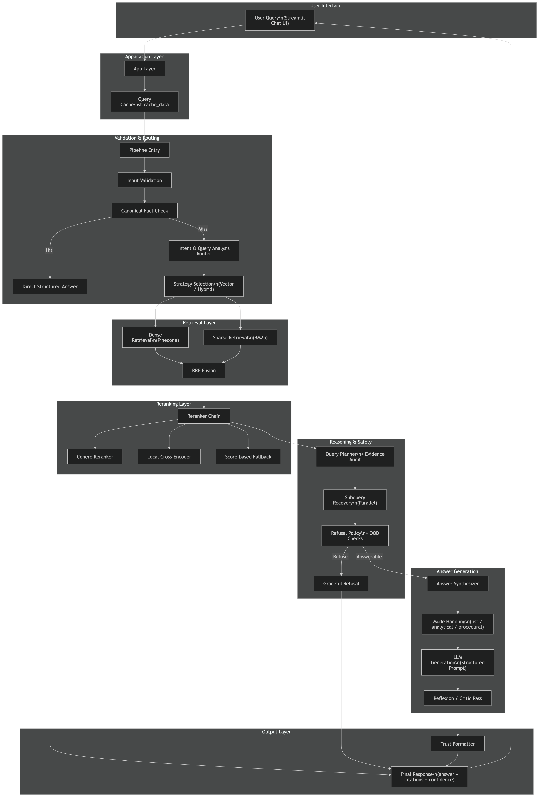

# Nexus RAG Interview Coach

Domain-specific retrieval-augmented question answering for AI/ML interview preparation, with dense + BM25 retrieval, reranking, citations, refusal handling, and evaluation workflows.

[Live Demo](https://nexus-rag.streamlit.app/) | [Deployment Guide](DEPLOYMENT.md)

Ask interview-style questions about LLMs, embeddings, vector search, RAG, alignment, and evaluation. The Streamlit chat app provides structured explanations with source and trust summaries, grounded in a curated AI/ML corpus.

## Capabilities

- **Corpus preparation:** section-aware document chunking, OpenAI `text-embedding-3-large` embeddings, and Pinecone storage.
- **Retrieval:** intent-based vector or hybrid search, combining dense retrieval and BM25 through reciprocal rank fusion.
- **Reranking:** Cohere with score-based fallback; an optional local cross-encoder can be enabled for additional resilience.
- **Evidence recovery:** query decomposition, coverage checks, and parallel support retrieval when initial evidence is insufficient.
- **Answer generation:** interview-oriented response structure, rule-based critique and repair, citations, and domain-scoped refusals.
- **Observability:** query traces, retrieval and answer metadata, stage timings, and repeated-query caching in the app.

## Architecture



The diagram summarizes available paths; routing and configuration determine which stages run for a given request.

1. The app receives a question and checks its response cache.
2. The pipeline validates input and checks supported canonical facts before routing to vector or hybrid retrieval.
3. Retrieved candidates are fused where applicable, reranked, and checked for evidence coverage; support queries recover additional context when needed.
4. The synthesizer produces a structured answer or refusal, with optional critique and repair.
5. The trust formatter returns answer text, citations, confidence signals, and trace metadata to the chat UI.

The local cross-encoder is disabled by default (`LOCAL_RERANKER_ENABLED=false`). Confidence signals are heuristic indicators, not calibrated probabilities of correctness.

## Local Setup

Use Python 3.11 and run commands from the repository root:

```bash
python3.11 -m venv venv
source venv/bin/activate
pip install -r requirements.txt
```

Set provider credentials and the target index using environment variables or a local `.env` file:

```bash
export OPENAI_API_KEY="..."
export PINECONE_API_KEY="..."
export PINECONE_INDEX_NAME="nexus-rag"
export PINECONE_NAMESPACE="tier1_v1"
export COHERE_API_KEY="..."
```

OpenAI and Pinecone credentials are required. Cohere is optional, but enables hosted reranking. Generation defaults to `gpt-4o-mini` and can be configured with `NEXUS_LLM_MODEL`.

The app requires a populated Pinecone index. For full hybrid retrieval, provide `cache/bm25_index.pkl` built from the same corpus. Raw corpus text is excluded from Git; a fresh clone alone does not recreate the knowledge base.

To prepare your own corpus, place compatible text documents in `data/raw/`, provision a Pinecone index compatible with the embedding model, and run:

```bash
python scripts/run_ingestion.py
python scripts/build_bm25_index.py
```

The ingestion script writes to `tier1_v1`; use the same namespace when starting the app. Ingestion calls provider APIs and writes vectors to the configured index. Without the BM25 cache, retrieval falls back to vector-only behavior.

Start the chat app:

```bash
streamlit run app.py
```

## Evaluation

Evaluation sets cover core interview questions, generalization, regression, domain edge cases, and shadow-test follow-ups. Run the pipeline evaluation and aggregate its results:

```bash
python src/evaluation/run_evaluation.py
python src/evaluation/aggregate_eval_metrics.py
python src/evaluation/aggregate_rag_quality_metrics.py
```

Use `EVAL_QUESTIONS_PATH` to select a question set and `EVAL_IDS` for a targeted run. `EVAL_OUTPUT_PATH` controls the runner output; set `EVAL_RESULTS_PATH` to the same path for aggregation. The runner overwrites its output file and incurs provider API usage.

Reported metrics include answer quality, hallucination and refusal rates, faithfulness, Recall@k, MRR, nDCG, context and citation precision/recall, and latency percentiles. Retrieval and evidence metrics depend on the supplied relevance labels and available trace data; judge scores are estimates, not guarantees for unseen queries.

## Deployment

The public demo uses Streamlit Community Cloud with `app.py` as the entrypoint. Configure secrets using [.streamlit/secrets.example.toml](.streamlit/secrets.example.toml) and follow [DEPLOYMENT.md](DEPLOYMENT.md) for setup and operational checks.

Keep real credentials out of Git and leave `NEXUS_SHOW_DEBUG=false` for public use. Monitor provider quotas, fallback rates, failures, and p95/p99 latency. Answer quality and response time depend on corpus coverage, retrieval configuration, and provider availability.

## Repository Layout

```text
app.py                         Streamlit chat interface
src/app_factory.py             Public app pipeline construction
src/pipeline/                  Ingestion and query execution
src/retrieval/                 Chunking, embeddings, search, routing, reranking
src/generation/                Synthesis, critique, refusals, trust formatting
src/evaluation/                Evaluation runners and metric aggregation
src/observability/             Routing metrics
scripts/                       Ingestion and BM25 index utilities
tests/                         Unit and integration tests
data/evaluation/               Evaluation question sets
docs/                          Architecture diagram
```

## Scope

Nexus RAG supports interview preparation within its AI/ML corpus. It is designed to decline unrelated or unsupported requests. Citations and confidence signals help users inspect responses; they do not establish universal correctness or complete protection against adversarial inputs.
